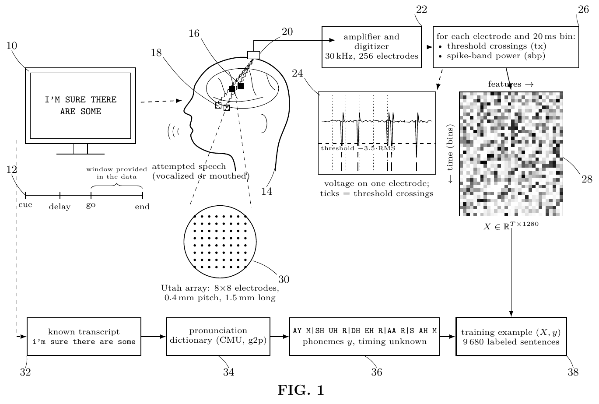
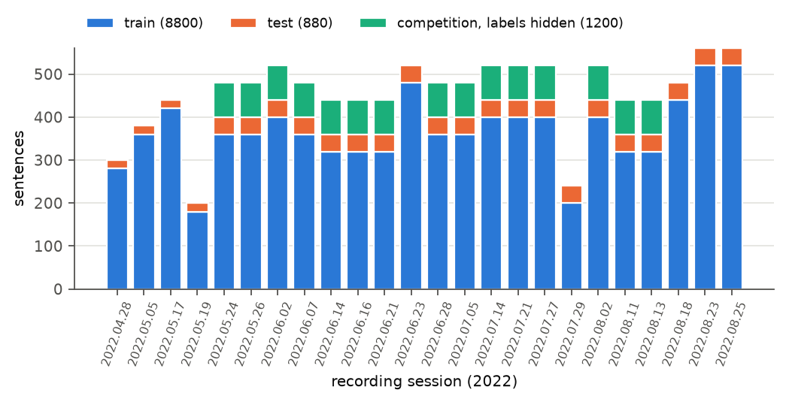
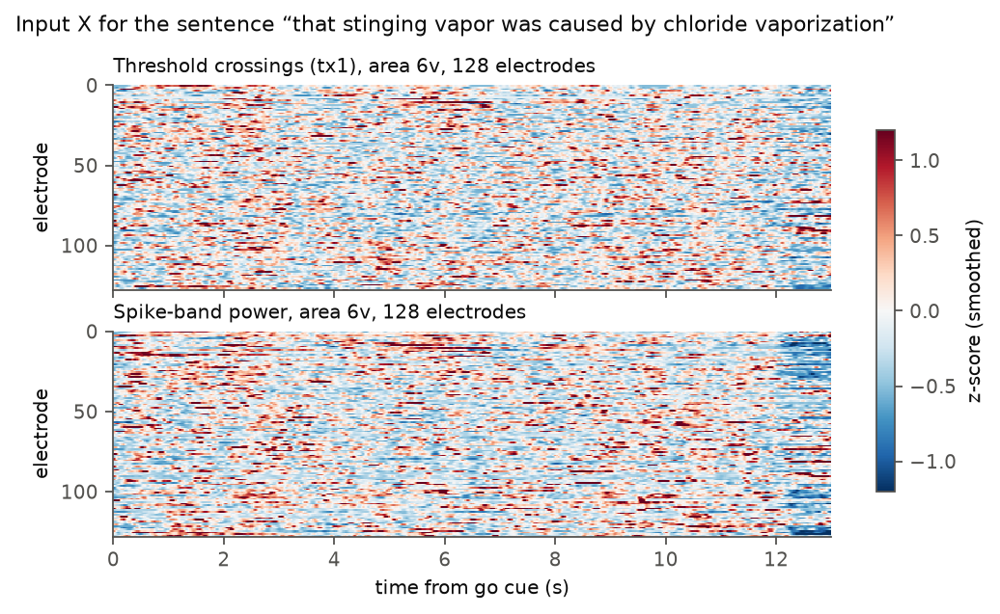
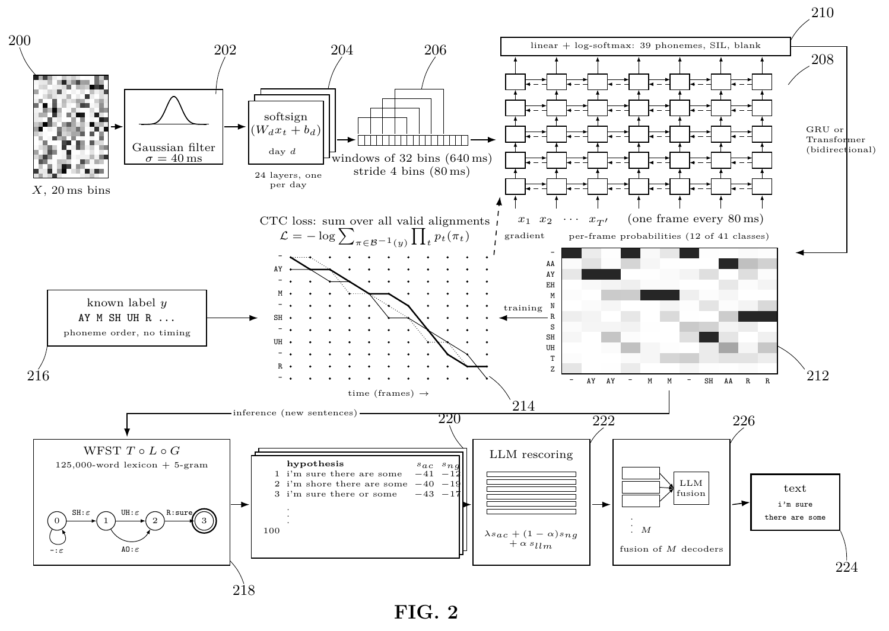
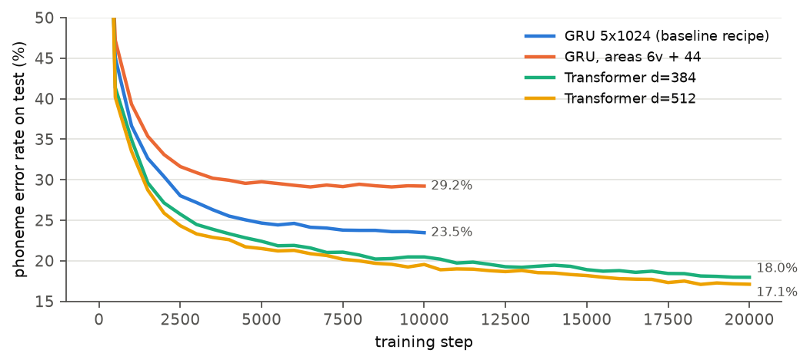
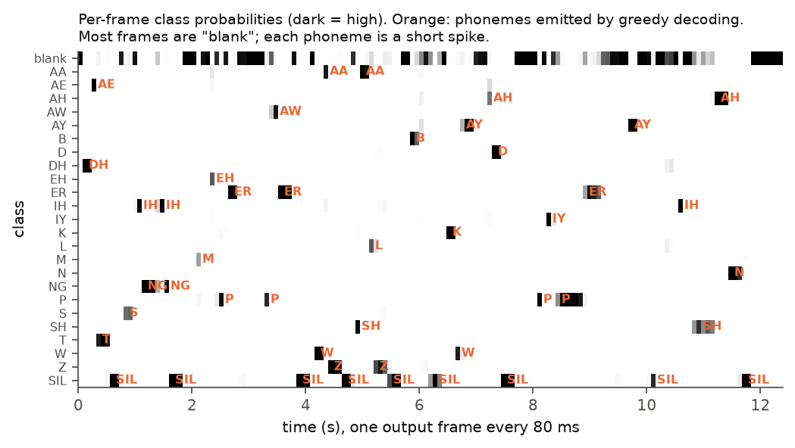
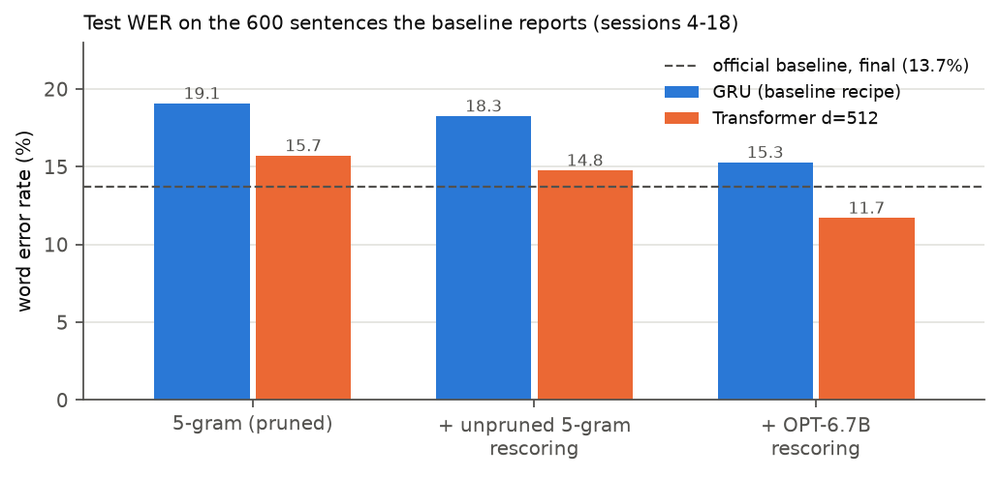

# How the pipeline works

This page explains what the code in this repository does, step by step. It is written for readers who know some machine learning but not this dataset.

Every number on this page was measured on the public `test` split. None of them has been scored on the competition leaderboard yet.

## 1. The experiment



The participant is T12, a person with ALS enrolled in the BrainGate2 clinical trial (Willett et al., 2023).

- **Implants.** Four Utah arrays (30) of 8×8 electrodes were implanted in the cortex:
  - two arrays (16) in area 6v, part of the ventral premotor cortex that controls the face and mouth;
  - two arrays (18) in area 44, part of Broca's area.
- **Trial structure.** A sentence appears on a screen (10). After a delay and a go cue (12), T12 attempts to say it, either aloud or by mouthing it silently. T12 can no longer produce intelligible speech, but the motor cortex still generates the command to move the mouth.
- **No onset detection.** The data contain only the window from the go cue to the end of the attempt, so the decoder never has to find where speech starts.
- **Recording.** The electrodes are sampled at 30 kHz (22). For each electrode and each 20 ms bin, two features are computed (26):
  - **Threshold crossings (tx):** how many times the voltage dropped below a threshold of −3.5 × RMS of that electrode (24; the data also provide −4.5, −5.5 and −6.5 × RMS as tx2–tx4). This is a cheap proxy for spikes from neurons near the electrode. It needs no spike sorting, which would not be stable over months.
  - **Spike-band power (sbp):** the power of the signal in the spike frequency band.

The released data contain 1,280 features per bin (tx at four thresholds plus sbp, for all 256 electrodes), so the figure shows X with 1,280 columns. The input to our decoder is a subset of that matrix, with one row per 20 ms bin. We use the 128 electrodes of area 6v × 2 features, which gives 256 columns. Area 44 carries little useful information (see the ablations below).

**What the decoder learns from.** The labels are the sentence transcripts (32), turned into phoneme sequences with a pronunciation dictionary (34, 36). Each training example is a pair (X, y) (38): neural activity plus phoneme sequence. The order of the phonemes is known, but not *when* each one was attempted. This missing timing is the central problem that CTC solves (section 3).



| Partition | Sentences | Sessions | Labels |
|---|---|---|---|
| train | 8,800 | 24 | released |
| test | 880 | 24 | released |
| competition | 1,200 | 15 | hidden, scored by EvalAI |

The sessions span four months. Electrodes move and neurons drift, so the same sentence produces different signals on different days. The model handles this with one input layer per day (section 2).

This is X for one test sentence:



Nothing in it is readable by eye. The model has to find the structure.

## 2. The neural decoder



The top row of the figure (200–210) is the network. It maps X to one probability distribution over 41 classes every 80 ms: 39 phonemes, SIL (the pause between words) and *blank* (no new symbol at this frame).

1. **Gaussian smoothing (202).** Each feature is smoothed over time with σ = 40 ms, because spike counts in 20 ms bins are noisy.
2. **Per-day input layer (204).** Each recording day d has its own affine map, followed by softsign: softsign(W_d x_t + b_d). The rest of the network is shared across days. This is how day-to-day drift is absorbed.
3. **Windows (206).** Consecutive windows of 32 bins (640 ms) are taken with a stride of 4 bins. This gives the network context and reduces the sequence length by 4×.
4. **Sequence model (208).** Either a 5-layer bidirectional GRU with 1,024 units (the baseline recipe) or a Transformer encoder (our best: 6 layers, d = 512, 8 heads). Both are bidirectional, so each output frame sees the whole attempt.
5. **Output (210).** A linear layer followed by log-softmax over the 41 classes.

Regularization:
- white noise and a random constant offset added to the input;
- dropout;
- for the Transformer, time masking: half of the time steps are blanked in random spans (the `m50` in the run names).



The y-axis is the phoneme error rate (PER) on test, measured with greedy decoding.
- **Transformer vs GRU.** The Transformer reaches 17–18% PER. The GRU trained with the baseline recipe stops at 23.5%.
- **Area 44.** Adding the area 44 electrodes to the GRU makes it worse (29.2%): those channels add noise, not information.

## 3. CTC: training without timing

The network emits about 150 frames for a 12 s sentence, but the label has only about 50 phonemes, with no indication of which frame belongs to which phoneme.

**Connectionist Temporal Classification** (CTC; 214 in the figure) works as follows:
- A frame-level sequence counts as a valid *alignment* of the label if it collapses to the label once repeated symbols are merged and blanks are removed. For example, `- AY AY - M - SH UH R R` collapses to `AY M SH UH R`.
- The CTC loss is the negative log of the total probability of all valid alignments. It is computed efficiently with dynamic programming, and its gradient trains the network.
- The network is never told where each phoneme is. It learns the timing because doing so increases the probability of the correct sequence.

After training, the output looks like this:



For the reference sentence *"that stinging vapor was caused by chloride vaporization"*, greedy decoding (taking the most likely class at each frame, then collapsing) gives:

```
DH AE T | S IH NG IH NG | M EH P ER P AW ER | W AA Z | SH AA L Z | B | K W AY AH D | P IY P ER AY | IH SH AH N |
```

Most words are recognizable, but some phonemes are wrong ("vapor" comes out as `M EH P ER`). Some words are broken or merged as well. Turning this into text is the job of the language models.

## 4. From phonemes to words

**Stage 1: WFST with a 5-gram (218, 220).** The phoneme probabilities are decoded against a weighted finite-state transducer that composes three parts:
- T: the CTC topology (how blanks and repeats collapse);
- L: a 125,000-word pronunciation lexicon;
- G: a 5-gram language model.

The result is the 100 best sentences, each with an acoustic score s_ac (how well it matches the phoneme probabilities) and an n-gram score s_ng. We use the WFST and language models released with the baseline. With 300 GB of RAM, the unpruned 5-gram can rescore the list.

**Stage 2: LLM rescoring (222).** OPT-6.7B assigns a log-probability s_llm to each of the 100 sentences. The final choice maximizes

```
λ·s_ac + (1 − α)·s_ng + α·s_llm
```

The weights λ and α are tuned on the test split.

**Stage 3: fusion of several decoders (226).** Different networks (different seeds and sizes) make different mistakes. For each sentence we collect the top 5 hypotheses of each of 6 decoders. An instruction-tuned LLM sees them together with how many decoders proposed each one, and writes the final sentence. It can combine parts of different hypotheses.

Real test sentences, best single decoder:

| | Example 1 | Example 2 | Example 3 |
|---|---|---|---|
| Reference | bringing something for a potluck picnic | if you've only got a token force there | they close sometime after eight |
| Greedy phonemes | `M R AE NG G AH N D \| S AH M TH AH NG D \| F AO R \| AH \| P AA L AH L IH K \| M IH K N IH K` | `IH F \| Y UW V \| AO N L IY \| G AA T \| AH \| S T OW K AH N \| F ER S \| DH EH R` | `DH EY \| K L OW Z \| S AH M P T L EH M \| AE F T ER \| IY T` |
| 5-gram, 1st | reagan something for a potluck picnic | if you've only got a second verse there | the lows sometime after e |
| + OPT-6.7B | reagan's something for a public picnic | if you've only got a token post there | they closed sometime after e |
| + fusion | **bringing something for a potluck picnic** | **if you've only got a token force there** | **they close sometime after eight** |

These examples were chosen because the fusion step fixed them. They show what each stage does, not how often each stage succeeds. The fusion step also makes errors of its own. For example, it rewrote *"we've got a stone from austin"* as *"we've got a ton from my son"*: an LLM prefers common phrases.

## 5. Where we are



| System | Test WER |
|---|---|
| Official baseline (GRU + 5-gram + OPT-6.7B), 600-sentence subset | 13.7% |
| Our GRU, same recipe, same subset | 15.3% |
| Our Transformer d=512 + unpruned 5-gram + OPT-6.7B, same subset | 11.7% |
| Fusion of 6 decoders, 200 random test sentences | 9.9% (preliminary) |

**Why the 600-sentence subset.** The baseline's 13.7% is measured on test sentences from sessions 4–18 only. The full test split, which includes the earliest and latest sessions, is harder. On the competition split, the same baseline scores 9.76%.

**Ablations:**
- **Unpruned 5-gram.** It needs about 300 GB of RAM. It lowers the n-gram WER by about 1 point, but after OPT rescoring the gain is only 0.2–0.4 points.
- **More threshold features.** Using all four threshold-crossing features (tx1–tx4) instead of tx1 alone makes the Transformer worse: 17.0% vs 15.2% WER after OPT, on all 880 sentences.
- **Area 44.** Adding the area 44 electrodes makes the GRU worse.
- **Our GRU vs the baseline GRU.** Ours is 1.6 points behind, even though it is bidirectional and theirs is not, and the decoding settings are identical. The gap is in the network or the preprocessing, not in the language models. We have not found the cause yet.

## 6. What comes next

Most of the remaining error comes from the neural decoder: about 17% of phonemes are still wrong before any language model is applied. The next work is:

- **Stronger decoders.** Larger Transformers, longer training, and other front-ends (convolutional subsampling instead of fixed windows, conformer blocks).
- **More diverse decoders.** Different seeds, architectures, feature sets and augmentations. Fusion works best when the models make different mistakes.
- **Final models.** Training on train + test before producing the competition submission.
- **A local fusion model.** The out-of-fold predictions saved with `train.py --fold k` are meant for training an open-weight LLM to do stage 3, so it does not depend on an external service.

## Reproducing the figures

```bash
.venv/bin/python docs/make_explainer_figs.py          # PNG plots from data and runs
cd docs/figs && pdflatex fig_esperimento_en.tex && pdflatex fig_modello_en.tex
pdftoppm -png -r 200 -singlefile fig_esperimento_en.pdf ../img/fig1_experiment
pdftoppm -png -r 200 -singlefile fig_modello_en.pdf ../img/fig2_model
```

## References

- Willett, F. R. et al. *A high-performance speech neuroprosthesis.* Nature 620, 1031–1036 (2023).
- Graves, A. et al. *Connectionist temporal classification.* ICML 2006.
- Zhang, S. et al. *OPT: Open pre-trained transformer language models.* arXiv:2205.01068 (2022).
